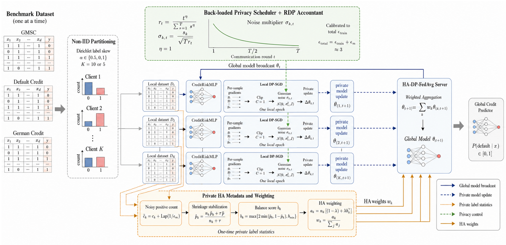

# HA-DP-FedAvg

Research code for **HA-DP-FedAvg: Privacy Scheduling and Heterogeneity-Aware
Aggregation for Federated Credit Risk Prediction**.

The method combines a back-loaded DP-SGD noise schedule with server aggregation
weighted by client sample counts and privately estimated label balance. The
experiments simulate federated learning with a shared credit-risk MLP.



## How it works

- [Privacy scheduling](src/privacy_schedule.py) and
  [accounting](src/privacy_accounting.py) calibrate a per-client noise schedule
  to a fixed total budget using Rényi differential privacy (RDP). The
  back-loaded schedule uses less noise in later communication rounds.
- [Aggregation](src/aggregation.py) releases noisy positive-label counts once
  for the HA variants, shrinks the resulting client rates toward the global
  rate, and uses the adjusted label-balance scores with sample counts to
  weight model updates.
- [Training](src/train_ha_dp_fedavg.py) composes the client training cost
  across local optimizer steps and includes the metadata cost in the reported
  budget. The maximum composed loss across disjoint clients is reported.

The benchmark uses a stratified train/validation/test split. Training records
are partitioned by label across clients using Dirichlet concentrations
`0.5` and `0.1`. The primary comparison uses ten paired seeds, 50 rounds,
full participation, and one local epoch per round. All four private variants
target a total ε of 3. The HA variants reserve ε = 0.1 for metadata. AUPRC
(average precision) is the primary ranking metric. The decision threshold
used for F1 is selected on validation data.

| CLI variant | Noise schedule | Server aggregation |
| --- | --- | --- |
| `dp_uniform` | Uniform | Sample size |
| `scheduler` | Back-loaded | Sample size |
| `ha_uniform` | Uniform | Private label balance |
| `full_ha_dp` | Back-loaded | Private label balance |

## Install and prepare the data

The paper used Python 3.10, PyTorch 2.6, and Opacus 1.6. From the repository root
in Bash:

```bash
python3.10 -m venv .venv
source .venv/bin/activate
python -m pip install "torch==2.6.0" "opacus==1.6.0" -r requirements.txt
```

For GPU runs, select a PyTorch 2.6 build compatible with your NVIDIA driver.
Training also supports CPU execution. Install the baseline extras for XGBoost
and the development extras for the test suite:

```bash
python -m pip install -r requirements-optional.txt
python -m pip install -r requirements-dev.txt
python -m pytest -q
```

Follow the [dataset setup guide](data/README.md) to download the original files
and place them at these paths:

| Dataset argument | Benchmark | Expected local file | Clients |
| --- | --- | --- | ---: |
| `default_credit` | Default of Credit Card Clients | `data/default_credit_card/default of credit card clients.xls` | 10 |
| `gmsc` | Give Me Some Credit | `data/give_me_some_credit/cs-training.csv` | 10 |
| `german` | Statlog German Credit | `data/german_credit/german.data-numeric` | 5 |

## Reproduce the experiments

Print the 80 planned configurations for one dataset. This command requires
the archived HA configuration but does not load the raw data or train a model.

```bash
python run_submission_extensions_v5.py \
  --dataset german --alphas 0.5 0.1 \
  --seeds 42 123 2026 31415 27182 73 101 909 4096 65537 \
  --epsilons 3 --rounds 50 --metadata-epsilon 0.1 \
  --variants dp_uniform scheduler ha_uniform full_ha_dp \
  --ha-config results/tables/default_credit_ha_tuning_v4_selected.json \
  --dry-run
```

With German Credit installed, exercise the HA training path on one
configuration for two rounds:

```bash
python run_submission_extensions_v5.py \
  --dataset german --alphas 0.5 --seeds 42 --epsilons 3 \
  --variants full_ha_dp \
  --ha-config results/tables/default_credit_ha_tuning_v4_selected.json \
  --output-prefix quick_check --smoke --resume
```

The [reproduction guide](docs/REPRODUCIBILITY.md) gives the full commands for
local training, Slurm, reference baselines, longer-round sensitivity,
calibration, and analysis. New runs write CSVs under `results/tables/`. The
[archived results](results/README.md) include per-seed data and summaries, so
you can rerun statistical analysis and generate comparison plots without
downloading any dataset.

## Privacy scope

The accounting targets fixed-size, replace-one record-level DP within a
client. Client participation is outside that privacy scope. The archived
benchmark uses the reproducible training RNG and reports the accounted ε.
The CSV fields `secure_rng` and `privacy_claim_valid` distinguish that setting
from runs that satisfy the implementation's stricter privacy-claim checks.

## Collaborators

Zihang Zeng and Yunkun Shi

## Citation and license

Please cite the paper and the code if you use this repository in published
work. See [citation metadata](CITATION.cff) and the [MIT License](LICENSE).
